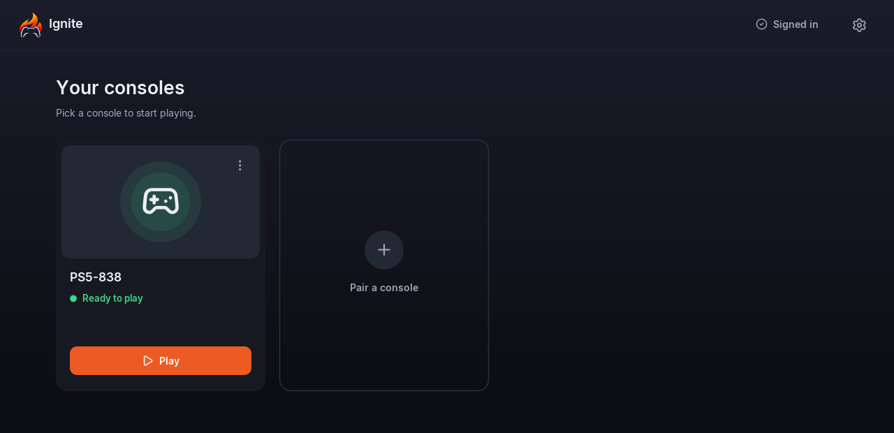

<p align="center">
  
</p>

<h1 align="center">Ignite</h1>

<p align="center">
  <a href="#features">Features</a> ·
  <a href="#download">Download</a> ·
  <a href="#building">Building</a> ·
  <a href="#documentation">Documentation</a> ·
  <a href="#license">License</a>
</p>

An open source PlayStation 5 Remote Play client for Windows and Linux, written in C# / .NET.
As simple as the official app (sign in, pair your PS5, play), with real control over stream
quality.

<p align="center">
  
</p>

## Features

- Guided first-run setup: PSN sign-in, pairing and quality
- Automatic discovery of consoles on the local network, wake from rest mode
- 360p to 1080p, 30/60 fps, H.264, HEVC or HEVC HDR, bitrate up to 100 Mbps
- Hardware video decoding (D3D11VA on Windows, VAAPI on Linux) with software fallback; H.264 on
  Windows is decoded in software, since D3D11VA cannot handle the PS5's H.264 slices
- DualSense haptics and adaptive triggers, other SDL gamepads, keyboard fallback

## Download

Get the latest version from [Releases](https://github.com/lucasdcampos/ignite/releases/latest):

- Windows: `Ignite-win-x64-Setup.exe` installs Ignite for your user, no administrator rights
  needed. Windows may warn that the publisher is unknown; choose "More info", then "Run anyway".
- Linux: download the `.AppImage`, make it executable and run it.

Ignite checks for new versions when it starts and asks before downloading one.

## Building

Requires the .NET 10 SDK. The first build downloads a pinned LGPL build of FFmpeg 9; build
with `-p:IgniteBundleFfmpeg=false` to use one installed on the system instead.

```
dotnet build
dotnet test
dotnet run --project src/Ignite.App
```

## Documentation

[Architecture](docs/architecture.md) · [Remote Play protocol](docs/protocol/README.md) ·
[Dependencies and licensing](docs/dependencies.md) · [Contributor guidelines](AGENTS.md)

## License

[MIT](LICENSE). Ignite is not affiliated with or endorsed by Sony Interactive Entertainment.
"PlayStation", "PS5" and "DualSense" are trademarks of Sony Interactive Entertainment Inc.
